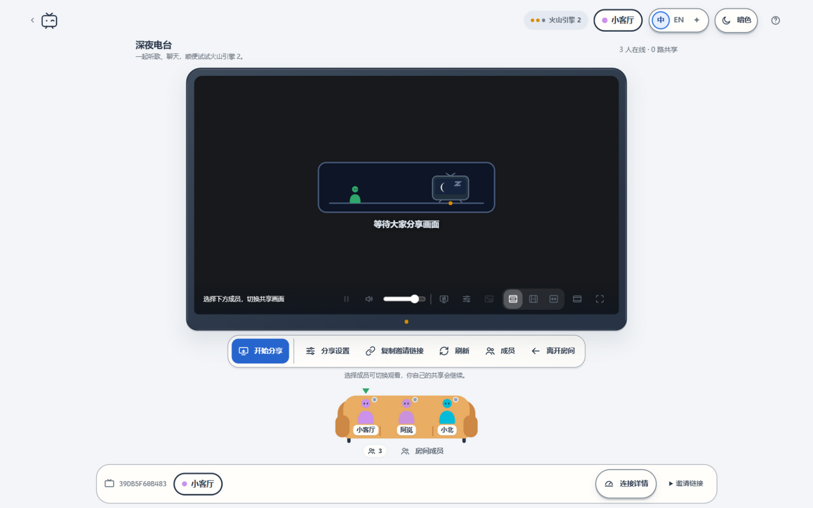

# Piik-RTC

Piik-RTC 是一个多人屏幕共享客厅。输入用户名即可创建或加入房间，推荐使用火山引擎 RTC（含两个独立应用），同时支持声网和即构，无需注册或安装客户端。除网页版外，还提供 Windows 桌面端。

## 功能特性

- **多人同时共享**：多人可同时共享屏幕、窗口或标签页，点击成员切换观看；支持音量、画中画、画面适配和全屏。
- **多家 RTC 服务商**：同时支持声网和即构，可在创建房间时按需选择。
- **可调共享画质**：分辨率支持 480p、720p、1080p、1440p，桌面端还可共享原画；帧率 15 / 24 / 30 / 60 fps，默认根据分辨率和帧率自动选择码率上限，也可手动指定 1–16 Mbps；可按清晰或流畅优先单独调整，并提供轻量、高清、高帧率三个预设。即构房间自动限制在 1080P / 10 Mbps。
- **流畅度诊断**：1080p60 均衡共享优先保持帧率；连接详情区分采集、发送、接收、解码和实际播放帧率，诊断报告保留最近约 4 分钟媒体采样。
- **开箱即用**：输入用户名即可创建或加入房间，无需注册或安装客户端。
- **按需连接**：空闲时自动断开媒体连接；空房间连续 15 分钟后自动关闭。
- **用量监控**：服务状态页展示供应商余量与本地估算，接近额度时阻止新建并关闭对应服务商的房间。
- **易用界面**：亮暗主题、中英文切换、响应式布局，提供连接统计、问题排查和脱敏诊断报告。
- **Windows 桌面端**：单文件约 6.4 MB、免安装，使用系统 WebView2，不打包 Chromium。
- **桌面端原生采集**：程序/屏幕缩略图选择器、只共享某个程序的声音、共享系统声音并过滤 Oopz / KOOK 等语音软件；不采集麦克风或摄像头。

> **免费额度**：声网、即构各提供每月 10,000 分钟；火山引擎的两个应用各自提供每月 10,000 分钟。实际额度以服务商控制台和活动规则为准。
>
> **推荐火山引擎 RTC**：根据[火山引擎官方文档](https://docs.volcengine.com/docs/real-time-communication/resource-package?lang=zh#freepakage)，免费资源包统一按 1:1 抵扣——纯音频，360P、720P、1080P、2K、4K 视频，每 1 分钟都只消耗 1 分钟资源包；因此同样的免费额度下，火山引擎更适合高分辨率屏幕共享。

## 截图

| 欢迎页 | 房间内 |
| :---: | :---: |
|  |  |

| 房间大厅 | 创建房间与 RTC 服务商 |
| :---: | :---: |
|  |  |

| 服务状态与用量 |
| :---: |
|  |

## 最快部署

需要 Docker 与 Docker Compose，并至少准备一家 RTC 服务商的凭据。

```bash
git clone <你的仓库地址> Piik-RTC
cd Piik-RTC
cp .env.example .env
# 编辑 .env，至少填写一家 RTC 服务商的凭据
docker compose up -d
```

打开 `http://服务器IP:3000`。屏幕共享需要 `localhost` 或 HTTPS；公网使用请配置 HTTPS 反向代理并设置 `PUBLIC_ORIGIN`。

完整的环境变量、Node.js / Docker / 反向代理 / 数据备份、双火山应用与即构 Cookie 说明见 [部署文档](docs/deployment.md)。

## 桌面端

桌面端是一个单文件、免安装的 Windows 程序，连接一台已部署的 Piik-RTC 服务器（不包含服务端）。构建：

```bash
npm run desktop:dev      # 复用/启动本地服务，构建并运行 release/Piik-RTC-v<版本>.exe
npm run desktop:build    # 构建单文件 release/Piik-RTC-v<版本>.exe
npm run desktop:build -- --server=https://piik.example.com   # 内嵌默认服务器
```

需要 Node.js 24+ 和 .NET 9 SDK（构建时发布内置音频组件）。运行需要系统 WebView2 运行时，Windows 11 和带 Edge 的 Windows 10 通常已自带。

首次启动填写服务器地址；构建时传入 `--server` 可以内嵌默认服务器；用户仍可在窗口内右键打开菜单，选择“服务器设置…”修改。程序声音和语音过滤需要 Windows 10 2004（19041）及以上。单文件约 6.4 MB，架构、限制和排障见 [docs/desktop.md](docs/desktop.md)。

桌面端启动时会检查最新版本，有新版时提示下载并自动重启；更新会并发探测多个 gh-proxy 镜像并选择最快线路，用多连接分段下载，镜像不可用时回退 GitHub 直连。

桌面端加载服务器上的网页前端，更新服务端网页资源后无需重新发布客户端。

## 开发

前端：React 19、TypeScript、Vite 7。后端：Node.js 24、Express 5、内置 SQLite、WebSocket。

| 路径 | 内容 |
| --- | --- |
| `src/` | 页面、播放器、房间与媒体状态管理 |
| `src/desktop/` | 桌面端桥接、选择器、PCM 音频管线 |
| `src/vendor/piik/` | 原样保留的 Piik 组件与资源 |
| `desktop/PiikDesktop/` | C# WebView2 单文件主机、原生采集与 IPC |
| `desktop/native/PiikAudio/` | C# WASAPI 系统/进程回环采集组件 |
| `server/` | API、Token 签发、实时同步与房间存储 |
| `scripts/build-desktop.mjs` | 发布音频组件、压缩嵌入并构建单文件 |
| `scripts/desktop-dev.mjs` | 本地服务 + 桌面端开发启动 |
| `scripts/vendor-piik.mjs` | 从上游重新导入 Piik |
| `docs/desktop.md` | 桌面端架构、构建与限制 |

运行 `npm test` 验证房间、权限、媒体状态和实时同步逻辑。桌面端需要在 Windows 上实际验证程序/屏幕共享、程序声音和语音过滤；网页版使用桌面 Chrome / Edge 验证。

## 许可

Piik-RTC 以 [MIT 许可](LICENSE)发布。

界面基于 [Piik](https://github.com/TNTcraftHIM/Piik)（MIT）并保留其版权声明；vendored 部分许可见 `src/vendor/piik/LICENSE`，其他第三方声明见 [THIRD_PARTY_NOTICES.md](THIRD_PARTY_NOTICES.md)。
