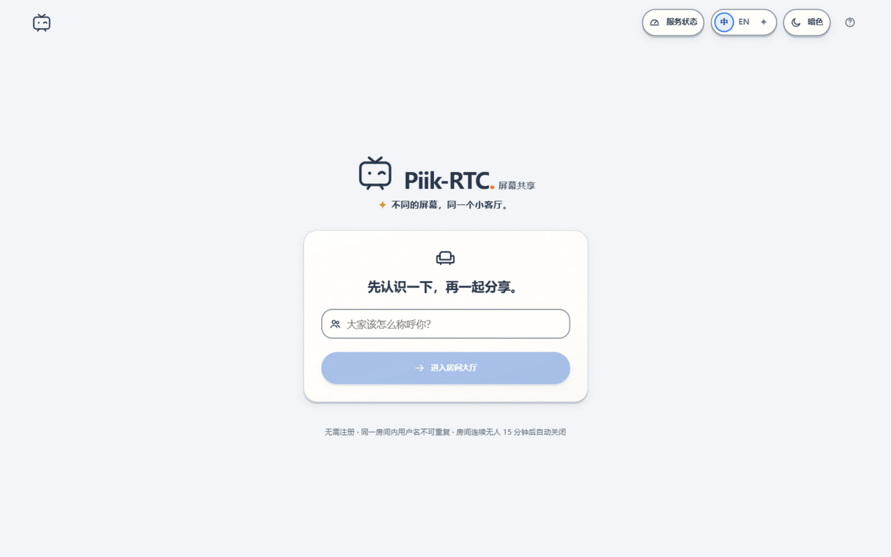
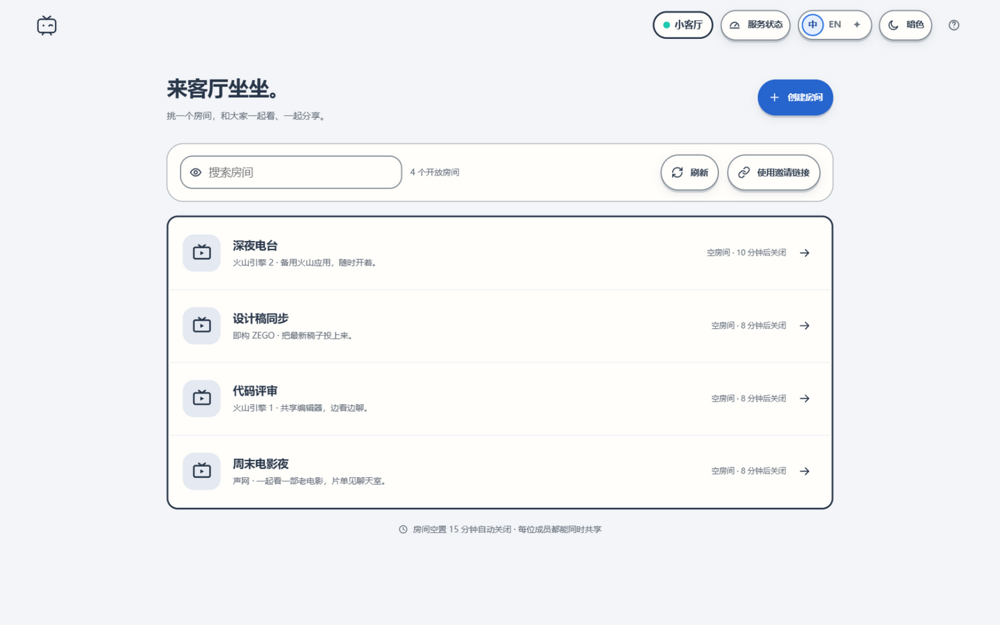
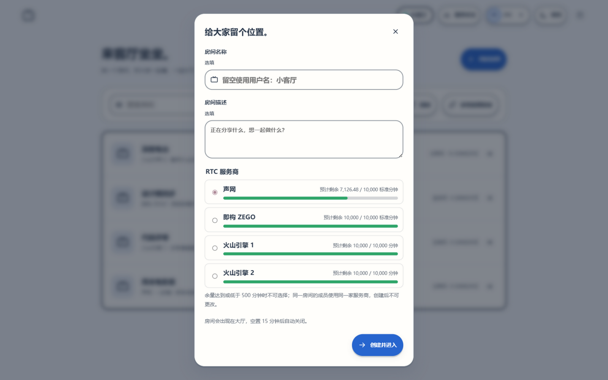
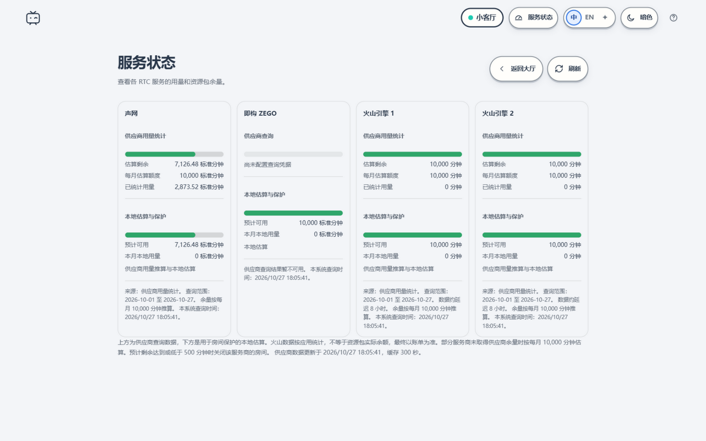

# Piik-RTC 部署与配置

本文是 Piik-RTC 的完整部署说明。只想快速跑起来，请回到 [README](../README.md)。



## 1. 部署前准备

- 源码运行：Node.js **24+**（使用内置 `node:sqlite`）。
- 容器运行：Docker 24+ 与 Docker Compose v2。
- 至少一个已开通并启用 Token 鉴权的 RTC 项目：
  - 声网：App ID + App Certificate。
  - 即构：AppID + ServerSecret。
  - 火山引擎：RTC AppID + AppKey；可选第二个火山应用。
- 如需显示供应商余额，再准备对应的用量查询凭据：
  - 声网：项目 ID、Customer Key、Customer Secret。
  - 火山引擎：具有 `rtc:ListUsages` 权限的 Access Key。
  - 即构：控制台登录 Cookie。
- 屏幕共享只能通过 `localhost` 或 HTTPS 使用，浏览器建议使用桌面版 Chrome / Edge。

## 2. 环境变量

复制模板并填写：

```bash
cp .env.example .env
chmod 600 .env
```

| 变量 | 必填 | 说明 |
| --- | --- | --- |
| `AGORA_APP_ID`、`AGORA_APP_CERTIFICATE` | 使用声网时 | 声网项目 App ID 和 App Certificate |
| `ZEGO_APP_ID`、`ZEGO_SERVER_SECRET` | 使用即构时 | 即构 AppID 和 ServerSecret |
| `ZEGO_COOKIE_FILE` | 可选 | 即构控制台 Cookie 文件路径，仅后端读取并保存续期状态 |
| `VOLC_RTC_APP_ID`、`VOLC_RTC_APP_KEY` | 使用火山时 | 火山 RTC AppID 和 AppKey |
| `VOLC_RTC_APP_ID_2`、`VOLC_RTC_APP_KEY_2` | 可选 | 第二个火山 RTC 应用，共用同一组火山 Access Key |
| `VOLC_ACCESS_KEY_ID`、`VOLC_ACCESS_KEY_SECRET` | 可选 | 火山用量查询密钥，需要对每个火山应用都有 `rtc:ListUsages` 权限 |
| `AGORA_PROJECT_ID`、`AGORA_CUSTOMER_KEY`、`AGORA_CUSTOMER_SECRET` | 可选 | 声网 REST 用量查询凭据 |
| `RTC_USAGE_CACHE_SECONDS` | 可选 | 服务状态服务端缓存秒数，默认 `300`，范围 1–86400 |
| `PORT` | 可选 | 服务端监听端口，默认 `3000` |
| `PUBLIC_ORIGIN` | 公网部署时 | 对外 HTTPS 来源，如 `https://screen.example.com`，用于 Cookie 安全属性和跨站请求校验 |
| `SCREEN_PORT` | 可选 | Docker Compose 映射到宿主机的端口，默认 `3000` |

注意：

- `.env` 不要提交到仓库，也不要加 `VITE_` 前缀；这些凭据只在服务端使用。
- 至少配置一家 RTC 服务商，否则无法创建房间。
- Docker 部署时，`ZEGO_COOKIE_FILE` 填容器内路径，通常放在持久化的 `/app/data/` 下。
- 两个火山 AppID 必须不同；两组应用共用同一组 Access Key。

## 3. Node.js 部署

```bash
npm ci
npm run build
npm start
```

- `npm run build` 先执行 TypeScript 检查，再构建前端到 `dist/`。
- `npm start` 以生产模式启动 `server/index.js`，由 Express 直接提供 `dist/` 静态文件。
- 开发调试使用 `npm run dev`，Vite 以中间件模式运行并支持热更新。
- 默认访问 `http://localhost:3000`，可用 `PORT` 修改。

使用 systemd 托管时，可参考：

```ini
[Unit]
Description=Piik-RTC
After=network.target

[Service]
Type=simple
WorkingDirectory=/opt/piik-rtc
Environment=NODE_ENV=production
ExecStart=/usr/bin/node server/index.js --production
Restart=on-failure
User=piik-rtc
Group=piik-rtc
NoNewPrivileges=true
PrivateTmp=true

[Install]
WantedBy=multi-user.target
```

确保运行用户对项目下的 `data/` 目录有写权限。

## 4. Docker Compose 部署

```bash
cp .env.example .env
chmod 600 .env
docker compose up -d
```

Compose 会拉取 `ghcr.io/nth2miss/piik-rtc:latest` 预构建镜像，默认映射宿主机 `3000` 端口，可用 `SCREEN_PORT` 修改：

```bash
SCREEN_PORT=8080 docker compose up -d
```

`pull_policy: always` 表示每次 `up` 都会检查并拉取最新 `latest`。需要固定版本时，把 `image` 改成 `v1.2.3` 这类标签。私有 GHCR 包需先执行 `docker login ghcr.io`。

常用命令：

```bash
docker compose logs -f          # 查看日志
docker compose pull             # 拉取新镜像
docker compose up -d            # 重建容器
docker compose down             # 停止并删除容器，保留数据卷
```

房间事件会逐行写入容器日志，包括创建房间、加入房间、开始/结束共享和退出房间，每条带上北京时间、来源 IP、房间名（房间号）、用户名与服务商，例如：

```
[2026-01-01T16:00:00.000+08:00] 加入房间 ip=203.0.113.10 room=周末放映室（d8aa717652e1） name=房主 provider="volc(火山引擎 1)"
```

反向代理与 Node 同机或同 Docker 网络部署时，来源 IP 取自 `X-Real-IP` 或 `X-Forwarded-For` 的第一跳，请确保代理转发或覆盖这两个请求头。若日志仍显示 `172.x` 这类 Docker 网关地址，说明请求没有经过带转发头的反向代理：从 Docker 宿主机本地访问、或使用 Docker Desktop 时会出现这种情况，可通过宿主机反向代理或 `network_mode: host` 获取真实来源。日志只输出到标准输出，不写入数据库，可用 `docker compose logs` 或宿主机日志收集工具留存。

镜像名必须与 GitHub 仓库或 GHCR 包名一致。如果仓库尚未改名为 `Piik-RTC`，请把 `docker-compose.yml` 中的 `piik-rtc` 换成实际名称，或使用下面的本地构建方式。

### 本地构建镜像

```bash
docker build -t piik-rtc .
docker run -d --name piik-rtc --restart unless-stopped \
  -p 3000:3000 --env-file .env \
  -v piik-rtc-data:/app/data piik-rtc
```

### 离线传输镜像

```bash
docker save piik-rtc | gzip > piik-rtc.tar.gz
# 在目标服务器
docker load < piik-rtc.tar.gz
```

构建架构必须与目标服务器一致（例如服务器是 `linux/amd64`，本地是 Apple Silicon 时需要指定 `--platform linux/amd64`）。

## 5. Docker CLI 部署

```bash
docker pull ghcr.io/nth2miss/piik-rtc:latest
docker run -d --name piik-rtc --restart unless-stopped \
  -p 3000:3000 --env-file /opt/piik-rtc/.env \
  -v piik-rtc-data:/app/data ghcr.io/nth2miss/piik-rtc:latest
```

更新时拉取镜像并重建容器，保留数据卷：

```bash
docker pull ghcr.io/nth2miss/piik-rtc:latest
docker rm -f piik-rtc
docker run -d --name piik-rtc --restart unless-stopped \
  -p 3000:3000 --env-file /opt/piik-rtc/.env \
  -v piik-rtc-data:/app/data ghcr.io/nth2miss/piik-rtc:latest
```

## 6. HTTPS 与反向代理

公网部署必须使用 HTTPS，并设置：

```dotenv
PUBLIC_ORIGIN=https://screen.example.com
```

除普通请求外，代理还需要转发 `/ws` 的 WebSocket Upgrade。Nginx 示例：

```nginx
server {
    listen 443 ssl http2;
    server_name screen.example.com;

    ssl_certificate     /etc/letsencrypt/live/screen.example.com/fullchain.pem;
    ssl_certificate_key /etc/letsencrypt/live/screen.example.com/privkey.pem;

    location / {
        proxy_pass http://127.0.0.1:3000;
        proxy_http_version 1.1;
        proxy_set_header Host $host;
        proxy_set_header X-Real-IP $remote_addr;
        proxy_set_header X-Forwarded-For $proxy_add_x_forwarded_for;
        proxy_set_header X-Forwarded-Proto $scheme;
    }

    location /ws {
        proxy_pass http://127.0.0.1:3000;
        proxy_http_version 1.1;
        proxy_set_header Upgrade $http_upgrade;
        proxy_set_header Connection "upgrade";
        proxy_set_header Host $host;
        proxy_read_timeout 3600s;
    }
}
```

Caddy 会自动处理 WebSocket：

```caddyfile
screen.example.com {
    reverse_proxy 127.0.0.1:3000
}
```

如果只在本机或局域网测试，可以直接访问 `http://IP:3000`，但浏览器不会允许非安全上下文共享屏幕。



## 7. 数据、备份与升级

房间、成员、用量估算和火山逐日用量都保存在 SQLite：

- 源码部署：`data/rooms.sqlite`，以及同目录下的 `-wal`、`-shm` 文件。
- Docker 部署：命名卷 `piik-rtc-data`，挂载到容器 `/app/data`。

备份时保留整个 `data/` 目录。运行中备份推荐使用 SQLite 的在线备份：

```bash
sqlite3 data/rooms.sqlite ".backup 'rooms-backup.sqlite'"
```

或停止服务后直接复制：

```bash
docker compose down
docker run --rm -v piik-rtc-data:/data -v "$PWD":/backup alpine \
  tar czf /backup/piik-rtc-data.tar.gz -C /data .
docker compose up -d
```

升级步骤：

```bash
docker compose pull
docker compose up -d
```

数据库表在启动时自动创建或补列，升级不会清空数据。跨大版本升级前仍建议先备份。

如果从旧的 `piik-sw` 部署迁移，数据卷名已改为 `piik-rtc-data`，需要把旧卷内容复制过来：

```bash
docker volume create piik-rtc-data
docker run --rm -v piik-sw-data:/from -v piik-rtc-data:/to alpine \
  sh -c 'cp -av /from/. /to/'
```

## 8. RTC 服务商配置



创建房间时选择服务商，房间创建后不可更改，所有成员使用同一家服务商。只配置一家时，创建界面只显示可用的服务商。

### 8.1 声网

- 在声网控制台创建 RTC 项目，启用 Token 鉴权。
- 填写 `AGORA_APP_ID`、`AGORA_APP_CERTIFICATE`。
- 如需显示用量，填写 `AGORA_PROJECT_ID`、`AGORA_CUSTOMER_KEY`、`AGORA_CUSTOMER_SECRET`。
- 声网按分辨率档位估算本地用量，HDP 汇总字段不会重复计入。

### 8.2 即构

- 填写 `ZEGO_APP_ID`、`ZEGO_SERVER_SECRET`（32 字节）。
- 共享画面最高 1080P。
- 即构额度查询使用控制台登录 Cookie 和控制台接口，而非官方公开 OpenAPI，可能随登录状态或接口变更失效。

Cookie 配置：

1. 在浏览器登录即构控制台，从开发者工具复制请求里的 Cookie，单行写入 `ZEGO_COOKIE_FILE` 指向的文件。
2. 文件只能由运行服务的用户读取：

```bash
chmod 600 data/zego-cookie.txt
```

3. 查询成功后续期会在原文件更新，不要提交或公开该文件。
4. 登录失效时状态显示 `auth_expired`，重新获取 Cookie 并替换文件即可恢复。

Docker 部署时，文件必须位于持久化的 `data/` 目录中，`.env` 里的路径是容器内路径。多实例不能各自维护同一登录会话，应使用统一的安全会话存储。

### 8.3 火山引擎（含双应用）

- 主应用：`VOLC_RTC_APP_ID`、`VOLC_RTC_APP_KEY`，界面显示为“火山引擎 1”。
- 可选第二应用：`VOLC_RTC_APP_ID_2`、`VOLC_RTC_APP_KEY_2`，界面显示为“火山引擎 2”。
- 两个应用共用 `VOLC_ACCESS_KEY_ID`、`VOLC_ACCESS_KEY_SECRET`，该密钥需要对两个应用都有 `rtc:ListUsages` 权限。
- 两个 AppID 必须不同；相同 AppID 不会被视为两个独立额度。
- 每个应用独立查询用量、累计本地用量并执行 500 分钟保护。

应用与槽位绑定：

- 首次启动时，服务端把 AppID 写入 `rtc_provider_bindings`，之后同一槽位只接受同一个 AppID。
- 配置后不要交换或替换 AppID，否则对应服务商会被停用，创建房间和签发 Token 返回 503。
- 只更换同一 AppID 的 AppKey 不受影响，可以正常轮换。
- 如果确实要更换 AppID，先停止服务并备份数据库，再清理该槽位的绑定、旧房间和相关用量记录，然后重启。这个操作会让该应用的历史用量估算失效，务必确认后再执行。

火山用量说明：

- `ListUsages` 只允许回查最近 30 天，服务端会把查询过的逐日数据保存到 SQLite，以覆盖 31 天月份。
- 如果月末首次启动或长期未查询，超出 30 天范围的日期无法补查，页面会提示统计不完整，不会把它当作完整供应商余量。
- 数据约延迟 8 小时，按免费包 1:1 比例和每月 10,000 分钟估算，不等同于资源包余额或最终账单。

## 9. 用量统计与额度保护

免费额度参考：声网、即构各提供每月 10,000 分钟；火山引擎的两个应用各自提供每月 10,000 分钟。实际额度以服务商控制台和活动规则为准。



即构未配置控制台 Cookie 时，供应商查询会显示“尚未配置查询凭据”，本地估算和保护仍然生效。

- 服务端按房间累计每个连接成员的估算用量，按北京时间自然月重新计量。
- 声网按分辨率和连接成员估算；即构按实际拉流档位估算；火山按免费包 1:1 比例估算。
- 供应商数据在服务端缓存，默认 300 秒；刷新页面不会绕过缓存。可用 `RTC_USAGE_CACHE_SECONDS` 调整。
- 估算余额达到或低于 **500 分钟**时：
  - 不允许新建该服务商的房间；
  - 关闭该服务商的所有房间并通知在线成员；
  - 已有 Token 仍可能有效至到期（Token 有效期 2 分钟），实际断流取决于供应商。
- 这不是硬性消费上限。供应商账单、网络延迟、客户端无法上报等情况都可能造成偏差，建议同时在供应商侧设置额度或停服机制。

## 10. 常见问题

**无法开始共享**

需要 HTTPS 或 `localhost`，并使用桌面版 Chrome / Edge。在浏览器选择器中选择屏幕、窗口或标签页；应用不采集摄像头或麦克风。

**共享没有声音**

共享时需要在浏览器选择器中勾选“共享音频”。窗口声音依赖较新的 Chrome / Edge 和操作系统支持。

**WebSocket 连接失败或成员状态不更新**

确认反向代理转发了 `/ws` 的 Upgrade，并适当增大 `proxy_read_timeout`。

**服务商显示未配置**

检查 `.env` 中的凭据格式、服务是否重启，以及火山 AppID 是否与已有绑定记录一致。凭据不完整时该服务商会在创建房间界面隐藏。

**即构显示“尚未配置查询凭据”或 `auth_expired`**

配置或更新 `ZEGO_COOKIE_FILE`。文件不存在、Cookie 过期或控制台接口变更都会导致查询不可用。即使查询不可用，本地估算仍会按每月 10,000 分钟继续保护。

**火山用量显示不完整**

`ListUsages` 只有 30 天回查窗口。保持服务长期运行，让服务端持续缓存逐日数据；页面出现“统计不完整”时不要把它当作完整余额。

**端口被占用**

修改 `PORT`；使用 Compose 时修改 `SCREEN_PORT`，不要修改容器内的 `PORT`。

**数据库无法写入**

确认 `data/` 目录对运行用户可写。Docker 镜像内使用非 root 的 `node` 用户，挂载宿主机目录时需要匹配权限。

**拉取 GHCR 镜像失败**

私有包需要 `docker login ghcr.io`。如果仓库或包名不是 `piik-rtc`，请修改 `docker-compose.yml` 中的镜像名，或按上面的本地构建方式部署。

## 11. 安全建议

- `.env` 和 `ZEGO_COOKIE_FILE` 只放在服务器上，权限设为 `600`，不要提交到仓库。
- 公网只暴露 HTTPS，反向代理到本机端口；不要直接暴露 `data/` 目录。
- 定期轮换 RTC AppKey、Access Key 和 ServerSecret；更换 AppKey 不需要清空用量数据。
- 定期备份 SQLite 数据卷，并对备份做访问控制。
- 服务端已对 API 做请求限流，但公开大厅仍建议配合反向代理的访问控制、WAF 或供应商额度限制使用。
- 诊断报告不包含访问令牌，但仍可能包含房间和浏览器信息，分享前请检查内容。

## 12. 开发与测试

```bash
npm install
npm run dev
npm test
npm run build
```

- 前端：React 19、TypeScript、Vite 7。
- 后端：Node.js 24、Express 5、内置 SQLite、WebSocket。
- `npm test` 覆盖房间、权限、媒体状态、用量统计和实时同步逻辑。
- 真实多端共享需要在桌面 Chrome / Edge 上验证。

第三方组件与许可信息见 [THIRD_PARTY_NOTICES.md](../THIRD_PARTY_NOTICES.md)。
